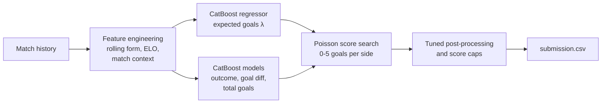

# GAMMAFEST 2026: International Football Score Prediction

> Predicting the exact final score of international football matches with **CatBoost**, **ELO ratings** and **Poisson-based score selection**. Built for the GAMMAFEST 2026 data science competition on Kaggle.


---

## Overview

The task is to predict `team_goals` and `opp_goals` for every international match in the test set. Each match appears twice, once from each team's point of view. The training data covers **78,772 team-match rows** going back to 1872, and the test set has **42,422 rows**.

The scoring rule rewards more than being close on goals. It adds penalties for a wrong exact score, a wrong goal difference and a wrong outcome (win, draw or loss), multiplies the loss by 1.5 when the outcome is wrong, and gives more weight to important tournaments such as the FIFA World Cup. So the notebook predicts the expected goals for each side, then picks the scoreline that fits this metric best.

## Approach



- **Rolling form.** Goals for and against, points, goal difference and win, draw and loss rates over each team's last 3, 5 and 10 matches.
- **ELO ratings.** Pre-match ELO for both teams, with a home advantage.
- **Match context.** Home or neutral venue, travel distance, population and GDP per capita differences, confederation, tournament type (friendly, qualifier, cup) and days since each team's last match.
- **Expected goals.** A CatBoost regressor predicts each team's expected goals (λ).
- **Score selection.** Every scoreline up to 5–5 is scored with the Poisson likelihood of both λ values, adjusted by the outcome, goal-difference and total-goal models, and the best one is picked.
- **Recency weighting.** Recent matches count more in training, using a tuned half-life (25 years in the final model).

## Validation

The notebook uses a time-based split: matches before 2008 are training data, and the 8,930 rows from 2008 to 2011 are the validation set. Every version is scored with a local approximation of the competition metric (lower is better).

| Version | What changed | Local score |
|---|---|---|
| V2 | CatBoost goals regressor + Poisson score search | 2.388 |
| V3 | Added an outcome classifier | 2.370 |
| V4 | Added goal-difference and total-goal models | 2.343 |
| V4B | Tuned the blend weights | 2.338 |
| V6 | Wider random parameter search | 2.336 |
| V7 | Separate tuning per tournament group | 2.332 |
| **V8 (final)** | Recency-weighted training (half-life 25) | **2.325** |

## Getting Started

The notebook was written for Kaggle and reads the competition files from `/kaggle/input/`.

1. Open the notebook on Kaggle and attach the competition dataset (`train.csv`, `test.csv`, `sample submission.csv`).
2. Run all cells in order. Each version builds on the functions defined by the earlier ones.
3. The final predictions are written to `/kaggle/working/submission.csv`.

To run it locally, install `pandas`, `numpy` and `catboost`, then change the input paths to your own copy of the data.

## Repository Structure

```
Gammafest-2026/
├── backburnerratakanan-notebook.ipynb   # Full pipeline, versions V2 to V8
└── README.md
```

## Author

**Athaya Akbar**: [GitHub @athaaaya](https://github.com/athaaaya)
